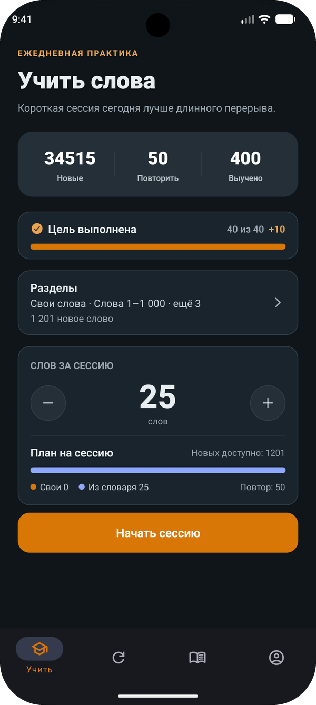
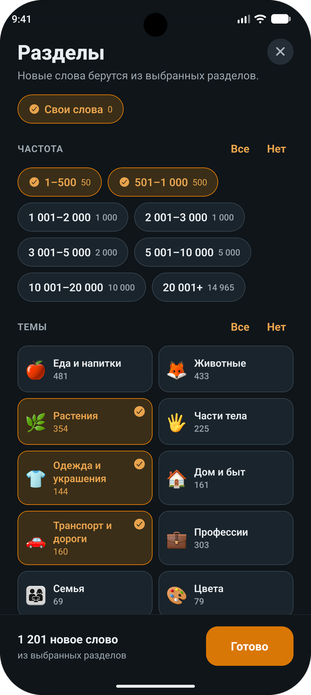
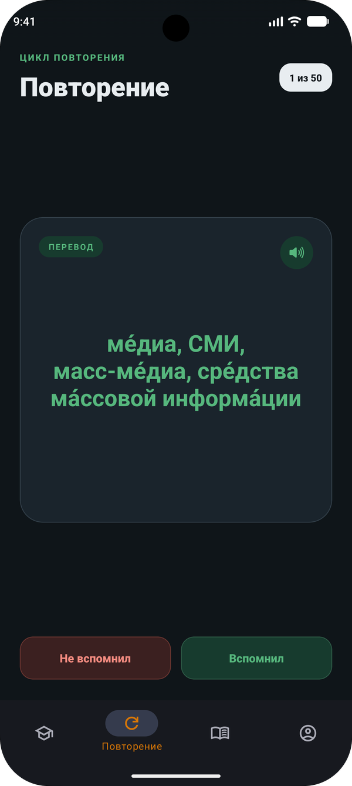
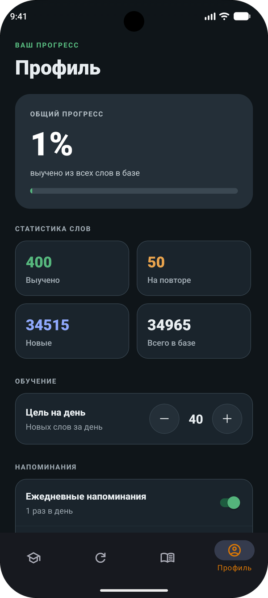
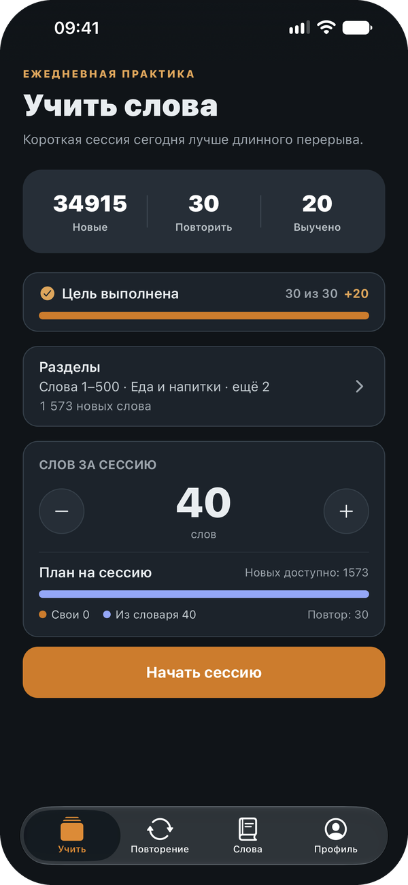
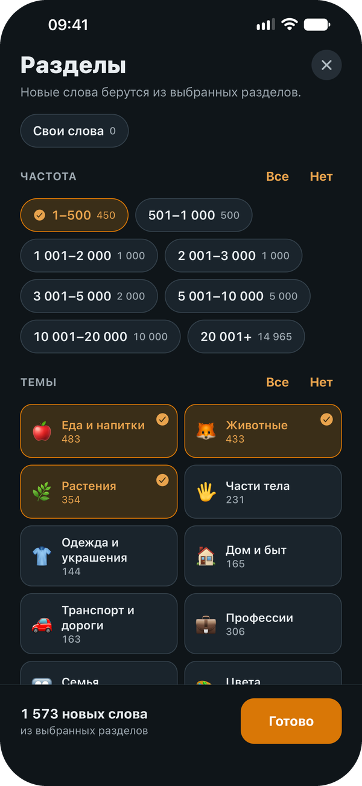
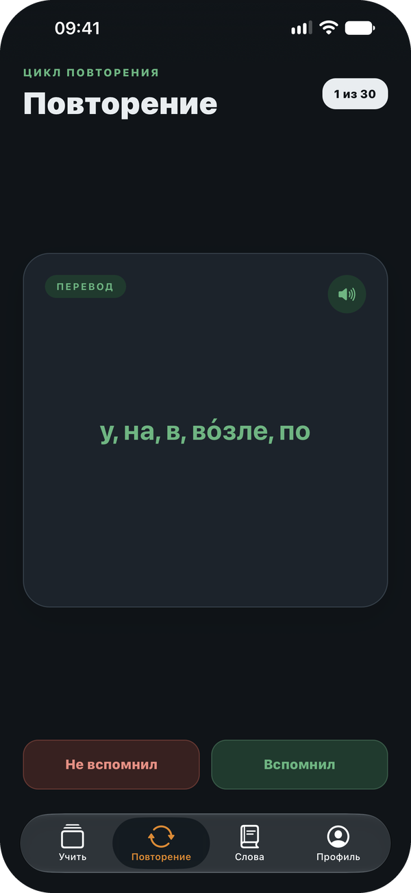
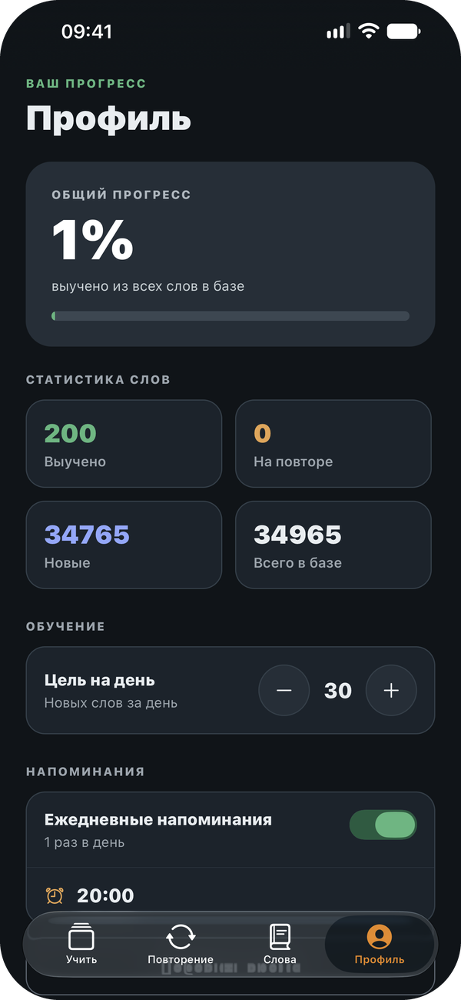

<div align="center">


# Cardlish

**Английские слова по карточкам — офлайн, без регистрации и рекламы**

[](https://github.com/01M/cardlish/releases/latest)

[](https://github.com/01M/cardlish/releases/latest)

[](https://expo.dev)
[](https://reactnative.dev)
[](https://www.typescriptlang.org)
[](#-источники-данных-и-лицензии)

[Возможности](#-возможности) •
[Установка](#-установка) •
[Словарь](#-встроенный-словарь) •
[Разработка](#-разработка) •
[Лицензии](#-источники-данных-и-лицензии)

</div>

<p align="center"><b>Android</b></p>

<p align="center">
  
  &nbsp;
  
  &nbsp;
  
  &nbsp;
  
</p>

<p align="center"><b>iPhone</b></p>

<p align="center">
  
  &nbsp;
  
  &nbsp;
  
  &nbsp;
  
</p>

## 📖 О проекте

**Cardlish** — приложение для заучивания английских слов по карточкам. Внутри уже есть
англо-русский словарь на 34&nbsp;965 слов с переводом, транскрипцией и произношением. Слова идут
от самых частых к редким, их можно выбирать по темам и добавлять свои.

Сервера нет: словарь, прогресс и настройки хранятся на телефоне, интернет не нужен.
Интерфейс на русском.

## ✨ Возможности

<table>
<tr>
<td width="50%" valign="top">
<h4>📇 Учить</h4>
На лицевой стороне карточки — слово и транскрипция, на обороте — перевод. Слово можно
прослушать. До начала сессии видно, сколько слов будет своих, а сколько из словаря.
</td>
<td width="50%" valign="top">
<h4>🗂️ Разделы</h4>
Свои слова, 8 диапазонов частотности (от 1–500 до 20&nbsp;001+) и 21 тема. Разделы можно
сочетать — слово всё равно попадёт в сессию один раз.
</td>
</tr>
<tr>
<td width="50%" valign="top">
<h4>🔁 Повторение</h4>
Пройденные слова ждут проверки: «Вспомнил» — слово выучено, «Не вспомнил» — оно остаётся на
повторении.
</td>
<td width="50%" valign="top">
<h4>✏️ Свои слова</h4>
Добавляйте свои слова, правьте и удаляйте их. Поиск и фильтр по статусу.
</td>
</tr>
<tr>
<td width="50%" valign="top">
<h4>🎯 Цель на день</h4>
От 5 до 50 новых слов в день. Прогресс виден на экране «Учить».
</td>
<td width="50%" valign="top">
<h4>🔔 Напоминания</h4>
До трёх в день в выбранное время. Когда цель выполнена, в этот день больше не беспокоят.
</td>
</tr>
<tr>
<td width="50%" valign="top">
<h4>📊 Статистика</h4>
Общий процент выученного и число слов в каждом статусе.
</td>
<td width="50%" valign="top">
<h4>🌗 Удобство</h4>
Светлая и тёмная тема, VoiceOver и TalkBack, уменьшение движения, тактильный отклик.
</td>
</tr>
</table>

### Как слово проходит обучение

<p align="center">
<b>🆕 Новое</b> &nbsp;→&nbsp; <b>🔁 На повторении</b> &nbsp;→&nbsp; <b>✅ Выучено</b>
</p>

«Далее» в сессии отправляет слово на повторение, «Вспомнил» — в выученные. Интервального
повторения (SRS) пока нет — оно в планах.

## 📲 Установка

1. Скачайте `cardlish-<версия>.apk` со страницы
   [последнего релиза](https://github.com/01M/cardlish/releases/latest).
2. Откройте файл на телефоне и разрешите установку из этого источника.

Нужен Android 7.0 или новее. В App Store приложения пока нет, хотя код поддерживает и iOS.

> [!WARNING]
> Это сборка вне Google Play. Если приложение появится в Play, перейти на ту версию можно будет
> только через удаление этой, и прогресс при этом не сохранится.

## 📚 Встроенный словарь

- **34&nbsp;965 слов** из англо-русского словаря [FreeDict](https://freedict.org/downloads/)
  (данные Викисловаря через WikDict) — только отдельные слова, без имён собственных, выражений
  и пословиц.
- **До пяти переводов** на карточку и **транскрипция** — американская, если она есть в словаре.
- **Порядок по частотности** из [wordfreq](https://github.com/rspeer/wordfreq): сначала самые
  употребительные слова.
- **21 тема** на основе [Open English WordNet](https://en-word.net/) с ручной проверкой.
- Нецензурная и оскорбительная лексика удалена, часть карточек исправлена вручную.

<details>
<summary><b>Все 21 тема</b></summary>
<br>

🍎 Еда и напитки · 🦊 Животные · 🌿 Растения · 🖐️ Части тела · 👕 Одежда и украшения ·
🏠 Дом и быт · 🚗 Транспорт и дороги · 💼 Профессии · 👨‍👩‍👧 Семья · 🎨 Цвета · ⏰ Время ·
⛅ Погода · 😊 Чувства и эмоции · 🩺 Здоровье и медицина · 🎓 Школа и учёба · ⚽ Спорт и игры ·
🎵 Музыка и танцы · 💰 Деньги и покупки · 💻 Техника и компьютеры · 🏔️ Природа и ландшафт ·
✈️ Путешествия

</details>

## 🧰 Разработка

### Запуск

Нужны [Node.js](https://nodejs.org) 26 (на нём идут сборки EAS) и npm.

```bash
git clone https://github.com/01M/cardlish.git
cd cardlish
npm install
npm start
```

Откройте проект в [Expo Go](https://expo.dev/go) по QR-коду или запустите эмулятор:
`npm run android` / `npm run ios`.

> [!NOTE]
> В Expo Go на Android уведомления не работают — начиная с SDK 53 их оттуда убрали. Приложение
> просто отключает напоминания. Чтобы проверить их, соберите APK (см. [Сборка](#сборка)).

### Проверки

```bash
npx tsc --noEmit   # типы
npm run lint       # линтер
npm test           # тесты
```

Тесты лежат рядом с кодом (`*.test.ts`). SQL-запросы схемы, синхронизации словаря и выборки
слов проверяются на настоящем SQLite через `node:sqlite`.

### Сборка

Сборки идут в облаке [EAS](https://expo.dev/eas): нужен аккаунт Expo, а Xcode и Android Studio
не нужны.

```bash
npx eas-cli@latest build --profile preview --platform android      # APK для телефона
npx eas-cli@latest build --profile production --platform android   # AAB для Google Play
```

### Стек

- **Приложение:** Expo SDK 57 · React Native 0.86 · React 19.2 · TypeScript (strict)
- **Навигация:** Expo Router, нативные вкладки (NativeTabs)
- **Данные:** expo-sqlite, версия схемы в `PRAGMA user_version`
- **Устройство:** expo-notifications · expo-speech · expo-haptics
- **Качество:** Jest + jest-expo · ESLint
- **Сборка словаря:** Python 3.14 · wordfreq · wn (только при пересборке)

### Структура проекта

<details>
<summary><b>Показать</b></summary>

```
src/
├── app/          маршруты Expo Router — только тонкие обёртки над экранами
├── screens/      экраны: Учить, Повторение, Слова, Профиль, Разделы, Источники
├── components/   общие компоненты интерфейса
├── hooks/        общие хуки
├── db/           SQLite: схема, синхронизация словаря, запросы
├── services/     уведомления и планировщик напоминаний
├── utils/        чистая логика: план сессии, разделы, цель на день, расписание
├── theme/        цветовые токены светлой и тёмной темы
├── assets/       готовые данные словаря и тем
└── data/         sources.json — источники данных и их лицензии
scripts/          Python-конвейер сборки словаря и тем, ручные правки в scripts/data/
assets/           иконки и заставка
docs/             разбор архитектуры и скриншоты
```

</details>

Как всё устроено внутри — в [docs/ARCHITECTURE.ru.md](docs/ARCHITECTURE.ru.md).

### Пересборка словаря

Готовый словарь уже лежит в репозитории (`src/assets/dictionary.json` и `topics.json`), так что
для запуска приложения Python не нужен. Пересобирать словарь нужно, только если изменился
конвертер или ручные правки в `scripts/data/`.

<details>
<summary><b>Команды (Windows)</b></summary>
<br>

Исходный архив `freedict-eng-rus-2025.11.23.src.tar.xz` скачивается с
[freedict.org](https://freedict.org/downloads/) и в репозиторий не входит.

```bash
py -V:3.14 -m venv scripts/.venv
scripts/.venv/Scripts/python.exe -m pip install -r scripts/requirements.txt

scripts/.venv/Scripts/python.exe scripts/convert_freedict.py <путь>/freedict-eng-rus-2025.11.23.src.tar.xz src/assets/dictionary.json
scripts/.venv/Scripts/python.exe scripts/build_topics.py src/assets/dictionary.json src/assets/topics.json

scripts/.venv/Scripts/python.exe -m unittest discover -s scripts -v
```

Результат детерминирован. `dictionary.json`, `topics.json` и `dictionary.version.json`
коммитятся вместе. Когда версия данных меняется, приложение обновляет словарь у пользователей,
не трогая их прогресс.

</details>

## 📜 Источники данных и лицензии

| Источник | Что используется | Лицензия |
| --- | --- | --- |
| [FreeDict eng-rus](https://freedict.org/downloads/) 2025.11.23 | слова, переводы, транскрипции | CC BY-SA 3.0 |
| [wordfreq](https://github.com/rspeer/wordfreq) 3.1.1 | порядок слов по частоте | данные — CC BY-SA 4.0 |
| [Open English WordNet](https://en-word.net/) 2025 | распределение слов по темам | CC BY 4.0 · WordNet License |
| Ручные исправления карточек | правки переводов, транскрипций и тем | CC BY-SA 4.0 |

Встроенный словарь распространяется на условиях
[CC BY-SA 4.0](https://creativecommons.org/licenses/by-sa/4.0/deed.ru). Авторы, список изменений
и тексты обязательных уведомлений — в [src/data/sources.json](src/data/sources.json) и на экране
**Профиль → Источники и лицензии** в приложении.

Лицензия на код приложения не выбрана, поэтому все права на него принадлежат автору.

<div align="center">
<br>
<sub>Сделано с ☕ и <a href="https://expo.dev">Expo</a></sub>
<br><br>
<a href="#cardlish">↑ Наверх</a>
</div>
