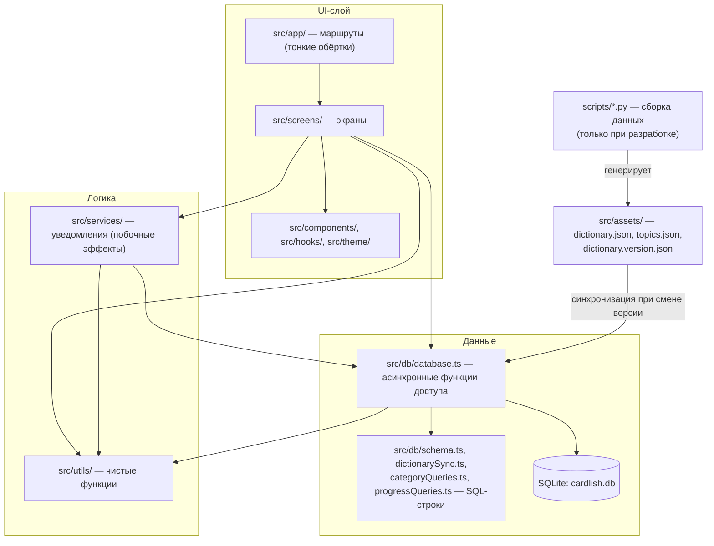
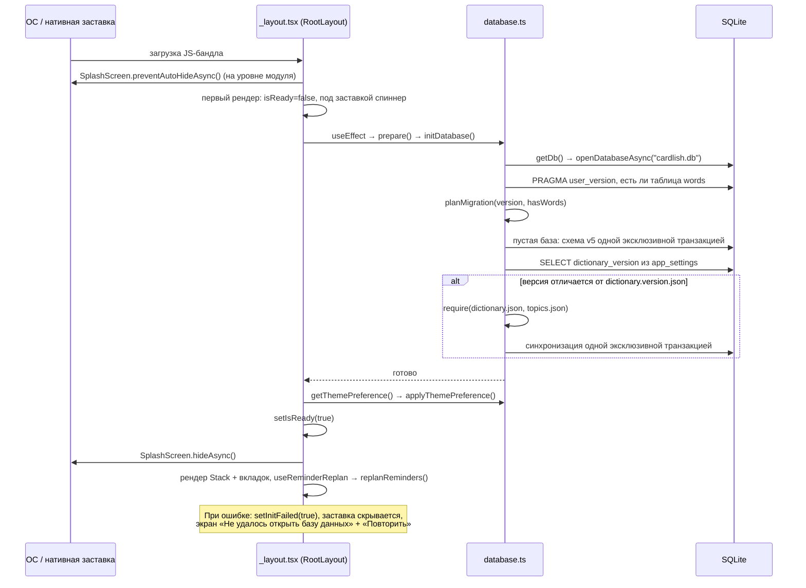
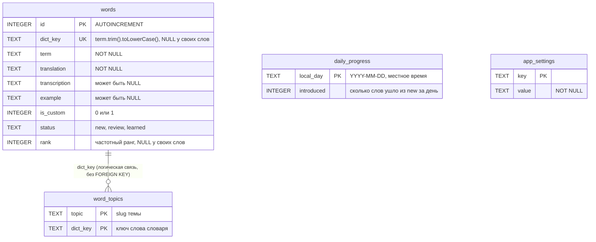
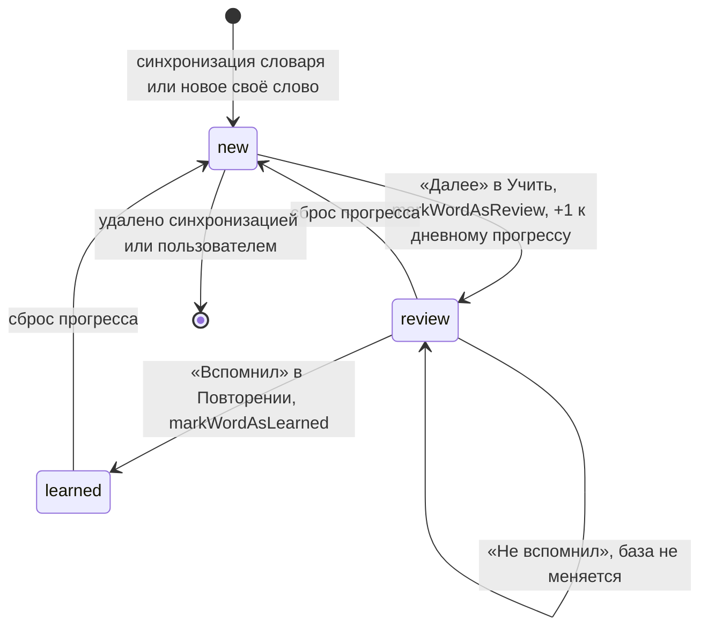
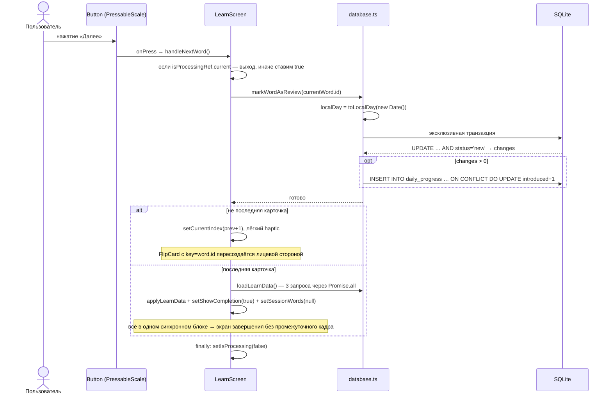
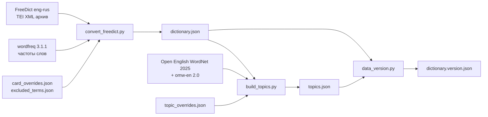

# Cardlish: как устроен проект

Технический разбор для студента, который знает основы программирования, SQL и синтаксис
JS/TS, но не работал с React Native и Expo. Каждое неочевидное утверждение снабжено ссылкой на
файл и функцию — их стоит открыть рядом с текстом. Где что-то нельзя проверить по коду
(поведение на устройстве, сборки в облаке), это сказано прямо: «не проверено».

Состояние кода — ветка `master`, коммит `d0fd3da`.

---

## 1. Обзор

**Cardlish** — офлайн-приложение для заучивания английских слов по карточкам. Пользователь:

- на вкладке «Учить» проходит сессию новых слов: переворачивает карточку (слово → перевод и
  транскрипция), слушает произношение, нажимает «Далее»;
- на вкладке «Повторение» отмечает «Вспомнил» / «Не вспомнил»;
- на вкладке «Слова» ведёт свой список слов (добавить, изменить, удалить, искать);
- в «Профиле» видит статистику, задаёт дневную цель, до трёх напоминаний в день, тему
  оформления и сбрасывает прогресс.

Встроенный словарь — 34 965 карточек (англо-русский словарь FreeDict), каждая с рангом
частотности. Новые слова берутся из выбранных «разделов»: свои слова, полосы частотности
(1–500, 501–1000, …) и 21 тема (еда, животные, …). Сервера нет: всё хранится в SQLite на
устройстве. Интерфейс на русском, код и идентификаторы — на английском.

### Технологии

| Компонент | Зачем |
|---|---|
| **Expo SDK 57** (`expo ~57.0.28`) | Набор библиотек и инструментов поверх React Native: доступ к API устройства без написания нативного кода, конфигурация через `app.json`. |
| **React Native 0.86** + **React 19.2** | UI пишется на React, но рисуется настоящими нативными элементами Android/iOS (`View`, `Text`), а не HTML. |
| **TypeScript ~6**, `strict: true` | Статическая типизация; проверка `npx tsc --noEmit`. |
| **expo-router ~57** | Маршрутизация по файлам: файл в `src/app/` — это экран. Включены типизированные маршруты (`experiments.typedRoutes` в `app.json`). |
| **expo-sqlite ~57** | Встроенная база SQLite (`cardlish.db`). |
| **expo-notifications** | Локальные уведомления-напоминания (без push-сервера). |
| **expo-speech** | Озвучка слова системным синтезатором речи (`FlipCard.tsx` → `speakWord()`, `language: "en-US"`). |
| **expo-splash-screen**, **expo-haptics**, **expo-linear-gradient**, **@expo/ui** | Заставка, тактильный отклик, градиенты, нативные элементы (SegmentedControl, выбор времени). |
| **EAS Build / Submit** | Облачная сборка APK/AAB и отправка в Google Play (`eas.json`). |
| **Python-скрипты** (`scripts/`) | На этапе разработки собирают словарь (`convert_freedict.py`), темы (`build_topics.py`) и версию данных (`data_version.py`). В приложение не входят. |
| **Jest 29** + пресет **jest-expo** | Модульные тесты TypeScript; SQL проверяется на настоящем SQLite из `node:sqlite`. Python — стандартный `unittest`. |

### Слои



Обратите внимание: `src/db/` тоже импортирует `src/utils/` (например, `database.ts` берёт
`parseSelection` и `toLocalDay`). Чистые функции — общий нижний слой, которым пользуются и
экраны, и база.

---

## 2. Структура проекта

| Папка | Ответственность |
|---|---|
| `src/app/` | Маршруты expo-router. Файлы экранов — одна строка: `src/app/(tabs)/index.tsx` импортирует `LearnScreen` и экспортирует его. Здесь же навигаторы: `_layout.tsx` (корневой Stack + инициализация БД) и `(tabs)/_layout.tsx` (нативные вкладки). |
| `src/screens/` | Реализация экранов: `LearnScreen`, `ReviewScreen`, `WordsScreen`, `ProfileScreen`, `CategoriesScreen`, `SourcesScreen`. |
| `src/components/` | Общие элементы интерфейса: `Button`, `PressableScale`, `FlipCard`, `FadeInView`, `WordFormModal`, `TimePickerModal`, `Confetti` и др. |
| `src/hooks/` | `useReduceMotion` (системная настройка «уменьшить движение»), `useReminderReplan` (перепланирование напоминаний). |
| `src/theme/` | Цветовые токены светлой и тёмной темы и хук `useTheme`. |
| `src/db/` | Всё про SQLite: схема, миграции, синхронизация словаря, запросы. |
| `src/services/` | Код с побочными эффектами вне базы: уведомления. |
| `src/utils/` | **Чистые функции** без React и без базы: план сессии, разделы, дневная цель, план напоминаний, склонение числительных. |
| `src/assets/` | Сгенерированные данные: словарь, темы, версия данных. |
| `src/data/sources.json` | Источники данных и лицензии (показываются на экране «Источники и лицензии»). |
| `scripts/` | Python-конвейер данных и его тесты; `scripts/data/` — ручные правки. |
| `assets/` | Иконки и заставка. |

**Чистая функция** (pure function) — функция, результат которой зависит только от аргументов и
которая ничего не меняет снаружи (не пишет в базу, не рисует, не читает часы). Пример —
`getSessionPlan(sessionSize, available)` в `src/utils/sessionPlan.ts`: на вход размер сессии и
число доступных слов, на выход — сколько своих слов и сколько слов словаря попадёт в сессию.

Зачем отделять такую логику от UI:

1. **Тестируемость.** Чистую функцию можно проверить одной строкой `expect(f(x)).toEqual(y)` —
   без телефона, без рендеринга компонентов, без подмены (mock) базы.
2. **Одна правда для нескольких мест.** Например, `selectionFilter()` из
   `src/utils/categories.ts` строит одно SQL-условие, которое используют и запрос сессии, и
   счётчик доступных слов. Поэтому число на экране совпадает с тем, что реально загрузится.
3. **Простые экраны.** Экран отвечает за состояние и отрисовку, а не за правила предметной
   области.

Цена — больше файлов и «прокладок»: экран вызывает `database.ts`, тот берёт SQL из
`categoryQueries.ts`, а условие — из `utils/categories.ts`.

Аналогично устроен слой БД: SQL лежит строками в `schema.ts`, `dictionarySync.ts`,
`categoryQueries.ts`, `progressQueries.ts`, которые **не импортируют expo-sqlite**. Поэтому эти
же строки выполняются в тестах на `node:sqlite` (раздел 11). Сам `database.ts` — тонкий
адаптер: открывает базу и выполняет готовый SQL.

---

## 3. Запуск приложения

Порядок от нажатия на иконку до первого экрана (`src/app/_layout.tsx`):



Ключевые решения:

- **Заставка держится до готовности базы.** `preventAutoHideAsync()` вызывается на уровне модуля
  (ещё до первого рендера), а `hideAsync()` — в эффекте, который срабатывает, когда выставлен
  `isReady` или `initFailed`. Пользователь не видит полупустой интерфейс и не может нажать
  кнопку, которая обратится к незаполненной базе. Цена — первый запуск, когда нужна
  синхронизация словаря, дольше показывает заставку (время на устройстве не измерено).
- **Тема применяется до показа приложения.** Сохранённое предпочтение (`theme_preference`)
  читается в `prepare()`; если чтение упало, используется системная тема — это не повод
  показывать экран ошибки.
- **Повтор после ошибки.** `handleRetry()` сбрасывает `initFailed` и снова вызывает `prepare()`.
  Заставки уже нет, поэтому виден собственный спиннер «Загрузка базы данных...». Открытие базы
  мемоизировано (`getDb()` в `database.ts` хранит промис), но при ошибке открытия промис
  сбрасывается, чтобы повтор действительно попробовал ещё раз.
- **Отдельный случай «база новее приложения».** Если `user_version` больше 5, бросается
  `DatabaseTooNewError`, и экран ошибки добавляет подсказку обновить приложение. Базу при этом
  не трогают: старое приложение не должно «чинить» схему, которую не понимает.
- **Отдельный случай «база старой версии».** Базы v1–v4 (и любая другая версия, которую
  приложение не знает) больше не переносятся (раздел 4): бросается `DatabaseUnsupportedError`, и
  экран ошибки просит удалить и заново установить приложение, предупреждая, что слова и прогресс
  при этом удалятся. Сама база не удаляется: молча стереть данные пользователя хуже, чем показать
  понятную ошибку.

**Мемоизация** (memoization) — запоминание результата, чтобы не вычислять его повторно. Здесь
запоминается промис открытия базы: все функции `database.ts` вызывают `getDb()` и получают одно
и то же соединение.

---

## 4. Модель данных



Схема описана в `src/db/schema.ts` (`CREATE_SCHEMA_V5`). Важные ограничения:

- `CHECK ((is_custom = 1) = (dict_key IS NULL))` — у своего слова ключа нет, у слова словаря он
  обязателен. Так два вида слов нельзя перепутать на уровне базы, а не только в коде.
- `CHECK (status IN ('new', 'review', 'learned'))` — недопустимый статус база не примет.
- `word_topics` объявлена `WITHOUT ROWID` с составным первичным ключом `(topic, dict_key)`: это
  таблица-связь «многие ко многим», и отдельный `rowid` ей не нужен.
- Внешнего ключа (FOREIGN KEY) у `word_topics` нет: таблицу целиком переписывает синхронизация
  словаря, и она сама следит, чтобы ссылки были на существующие строки (раздел 5).
- Индекс `idx_words_is_custom_status (is_custom, status)` ускоряет частые выборки по статусу.

### Что хранит `app_settings`

Таблица «ключ — значение» для настроек (все значения — текст):

| Ключ | Значение | Где читается |
|---|---|---|
| `dictionary_version` | версия данных, с которой синхронизирована база | `dictionarySync.ts` |
| `learn_categories` | JSON-массив ключей выбранных разделов; **нет записи = выбраны все** | `categoryQueries.ts`, `utils/categories.ts` → `parseSelection()` |
| `daily_goal` | дневная цель, 5–50 с шагом 5 | `utils/dailyGoal.ts` → `parseDailyGoal()` |
| `daily_reminder_enabled` | `"true"` / `"false"` | `database.ts` → `getReminderEnabled()` |
| `reminder_times` | JSON-массив `"HH:MM"`, 1–3 штуки | `utils/reminderTimes.ts` → `parseReminderTimes()` |
| `theme_preference` | `system` / `light` / `dark` | `database.ts` → `getThemePreference()` |

Общий принцип: **при чтении любое некорректное значение превращается в значение по умолчанию**
(например, `parseDailyGoal("abc")` → 10), а **при записи некорректное значение отвергается**
(`setDailyGoal(7)` бросает ошибку). Испорченная настройка не ломает приложение.

### Миграции через `PRAGMA user_version`

**Миграция схемы** (schema migration) — изменение структуры базы у уже установленных
пользователей без потери данных. SQLite хранит в заголовке файла целое число
`PRAGMA user_version`; приложение использует его как номер версии схемы (сейчас
`SCHEMA_VERSION = 5`).

**Почему цепочки переносов больше нет.** Схема менялась четыре раза (v2: ключ `dict_key` и
`CHECK`-ограничения; v3: `rank`; v4: `daily_progress`; v5: `word_topics`), и для каждой версии
был свой перенос, а для v1 → v2 ещё и копия файла через `VACUUM INTO`. Но приложение ни разу не
публиковалось, и единственная установленная сборка — у самого разработчика, уже на v5. Переносы
со старых версий никому не нужны, а код и тесты для них — около 600 строк, которые пришлось бы
поддерживать. Поэтому до первой публикации история схемы «сжата» (squashed): осталась только
текущая схема v5. Номер версии **не сбрасывался** на 1: база, которая уже на v5, продолжает
работать без переустановки. Это решение допустимо **только до публикации**: как только у
приложения появятся настоящие пользователи, каждое следующее изменение схемы снова должно быть
обычным пошаговым переносом с сохранением данных (рецепт ниже), а сжимать историю будет нельзя.

Решение «что делать» принимает чистая функция (`src/db/schema.ts`):

```ts
export const planMigration = (
  userVersion: number,
  hasWordsTable: boolean,
): MigrationPlan => {
  if (userVersion === 0 && !hasWordsTable) return "fresh";
  if (userVersion === SCHEMA_VERSION) return "current";
  if (userVersion > SCHEMA_VERSION) return "too-new";
  return "unknown";
};
```

Тонкость: у первой версии приложения `user_version` был 0 — так же, как у пустой базы. Поэтому
нужен второй признак — есть ли таблица `words`: «0 и таблицы нет» — новая установка, «0 и
таблица есть» — старая база v1. Она, как и версии 1–4 и отрицательные числа, попадает в
`"unknown"`: `migrateSchema()` бросает `DatabaseUnsupportedError`, базу не трогает, а экран
ошибки просит переустановить приложение (раздел 3).

Выполнение плана — `migrateSchema()` в `database.ts`. Для новой установки (`"fresh"`) она
выполняет `CREATE_SCHEMA_V5` и `SET_SCHEMA_VERSION` **в одной эксклюзивной транзакции**; для
`"current"` ничего не делает.

**Транзакция** (transaction) — группа операций, которая применяется целиком или не применяется
вовсе (атомарность). Почему одна транзакция и почему версия ставится последней:

- если телефон выключится посреди создания схемы (или будущего переноса), SQLite откатит
  незавершённую транзакцию, и при следующем запуске база будет в исходном состоянии — шаг просто
  повторится;
- не бывает состояния «таблицу создали, а версию не поменяли» (тогда следующий запуск попытался
  бы создать таблицу второй раз и упал бы) или наоборот.

`withExclusiveTransactionAsync` — API expo-sqlite; по документации expo-sqlite, в отличие от
`withTransactionAsync`, он гарантирует, что посторонние запросы того же приложения не попадут
внутрь транзакции. Это важно, потому что экраны и сервис напоминаний обращаются к базе
асинхронно и параллельно.

**Схема новой установки закреплена снимком.** `src/db/schema.v5.snapshot.json` — содержимое
`sqlite_master` (имена и SQL всех таблиц и индексов) и `user_version` новой базы. Снимок снят с
кода до удаления цепочки, и тест в `schema.test.ts` сравнивает с ним новую базу: так проверено,
что при сжатии истории схема не изменилась ни на символ, и любое случайное изменение
`CREATE_SCHEMA_V5` в будущем тоже упадёт в тестах.

Добавление новой версии (например, v6):

1. Увеличить `SCHEMA_VERSION` до 6.
2. Добавить в `schema.ts` SQL-шаг v5 → v6 (например, `MIGRATE_V5_TO_V6`) и изменить схему новой
   установки так, чтобы она совпадала с результатом переноса.
3. Добавить план `"upgrade-v5"` в `MigrationPlan` и ветку `userVersion === 5` в
   `planMigration`; в `migrateSchema()` — `case "upgrade-v5"`, который выполняет шаг и
   `SET_SCHEMA_VERSION` одной эксклюзивной транзакцией.
4. Обновить снимок схемы новой установки (осознанно, вместе с версией) и добавить тесты в
   `schema.test.ts` на `node:sqlite`: данные базы v5 сохраняются, итоговая схема совпадает со
   схемой новой установки, при сбое база остаётся v5.

---

## 5. Синхронизация словаря

Словарь поставляется внутри приложения как `src/assets/dictionary.json` (~6,2 МБ, 34 965
карточек) плюс `topics.json` (состав тем). При обновлении приложения словарь может измениться:
исправлены переводы, добавлены или удалены слова. Задача — перенести изменения в базу, **не
потеряв прогресс пользователя**. Отдельного пути «заполнить базу при первой установке» нет: новая
установка — это синхронизация в пустую таблицу.

### Когда запускается

`syncDictionaryIfNeeded()` в `database.ts` сравнивает `app_settings.dictionary_version` с
`src/assets/dictionary.version.json`. Это 16 первых hex-символов SHA-256 от содержимого обоих
JSON-файлов (раздел 10). Совпало — ничего не делаем; JSON-файлы при этом **даже не
загружаются**: они подключаются через `require` внутри функции (ленивая загрузка, lazy loading),
а не через `import` в начале файла. Иначе каждый запуск разбирал бы 6 МБ JSON.

Хэш вместо ручного номера версии выбран потому, что его невозможно забыть увеличить: изменился
любой байт данных — изменилась версия. Тест `src/assets/dictionary.test.ts` пересчитывает хэш и
падает, если версия устарела.

### Алгоритм

Все шаги строит чистая функция `planDictionarySync()` (`src/db/dictionarySync.ts`), а
`database.ts` выполняет их по порядку в одной эксклюзивной транзакции:

1. **Upsert карточек пачками по 500** (`buildUpsertBatches`). **Upsert** — «вставить, а если
   такая строка уже есть, обновить» (`INSERT … ON CONFLICT … DO UPDATE`):

   ```sql
   INSERT INTO words (dict_key, term, translation, transcription, example, rank, is_custom, status)
   VALUES (?, ?, ?, ?, ?, ?, 0, 'new'), …
   ON CONFLICT (dict_key) DO UPDATE SET
     term = excluded.term, translation = excluded.translation,
     transcription = excluded.transcription, example = excluded.example, rank = excluded.rank
   WHERE words.term IS NOT excluded.term OR words.translation IS NOT excluded.translation
     OR … OR words.rank IS NOT excluded.rank;
   ```

2. **Удаление исчезнувших слов** (`findKeysToDelete` + `buildDeleteBatches`): удаляются только
   строки словаря в статусе `'new'`, которых нет в новом JSON.
3. **Полная перезапись тем**: `DELETE FROM word_topics`, затем пакетная вставка из
   `topics.json` (`buildTopicInsertBatches`) с условием `WHERE EXISTS (SELECT 1 FROM words
   WHERE words.dict_key = …)` — ключ без строки словаря пропускается.
4. **Запись версии** — последним оператором.

### Что обновляется и что никогда не трогается

| Обновляется | Никогда не трогается |
|---|---|
| `term`, `translation`, `transcription`, `example`, `rank` | `id`, `status`, `is_custom` |
| | свои слова (`dict_key IS NULL`), даже если их `term` совпадает со словом словаря |
| | `daily_progress` |

**Сопоставление идёт только по `dict_key`, никогда по `id`.** id выдаёт `AUTOINCREMENT` в
порядке вставки, а порядок карточек в JSON менялся между версиями конвертера. У пользователя,
установившего приложение давно, и у нового пользователя у одного и того же слова разные id.
`dict_key` (`toDictKey(term)` = `term.trim().toLowerCase()`) от истории установки не зависит.

**Правило удаления.** Слово, которое пользователь уже учил (`review` или `learned`), остаётся,
даже если его убрали из словаря: удалить его — значит молча стереть прогресс. Условие
`is_custom = 0 AND status = 'new'` повторено прямо в SQL удаления, а не только в JS-фильтре, —
защита на случай, если список ключей окажется неверным.

### Почему это идемпотентно

**Идемпотентность** (idempotence) — свойство операции давать тот же результат при повторном
выполнении. Повторная синхронизация с теми же данными ничего не меняет:

- `WHERE … IS NOT excluded…` в `DO UPDATE` пропускает строки без изменений;
- удалять нечего — все ключи уже на месте;
- темы удаляются и вставляются заново в том же составе.

Тест `dictionarySync.test.ts` → «changes nothing when run a second time» это проверяет.
Есть и безвредный побочный эффект (он описан в CLAUDE.md, код его не исправляет): SQLite
выделяет новое значение `AUTOINCREMENT` даже для строки, которая в итоге ушла в `DO UPDATE`.
Поэтому каждая синхронизация сдвигает счётчик id примерно на размер словаря. Существующие id при
этом не меняются, а новые остаются уникальными. Сам эффект я не перепроверял.

### Почему сбой не оставляет «половину» данных

Всё — одна транзакция, а версия записывается последней. Если что-то упало на 40-й пачке,
транзакция откатывается целиком: в базе старые слова, старые темы и **старая версия**. Значит,
при следующем запуске (или по кнопке «Повторить») синхронизация начнётся заново. Если бы
версия писалась отдельно или в начале, приложение считало бы словарь обновлённым, хотя данные
остались бы наполовину старыми. Проверено тестами «rolls everything back, including the version,
when a step fails» и «rolls back to the old table and version when a step fails».

Пачки по 500 строк нужны из-за лимита SQLite на число параметров в одном запросе: 500 × 6 = 3000
параметров (тест «keeps the default batch under SQLite's variable limit»).

---

## 6. Процесс обучения

### Машина состояний слова

**Машина состояний** (state machine) — модель, где объект находится ровно в одном состоянии из
конечного набора, а переходы разрешены только определённые. Здесь состояние — колонка
`words.status`.



Переходы защищены прямо в SQL (`src/db/progressQueries.ts`):

```sql
UPDATE words SET status = 'review'  WHERE id = ? AND status = 'new';
UPDATE words SET status = 'learned' WHERE id = ? AND status = 'review';
```

Условие на текущий статус делает переходы безопасными при «устаревшем» экране: если сессия
«Учить» открыта со вчерашнего дня, а слово уже ушло дальше, повторное «Далее» его не откатит. Свои
слова можно удалить из любого состояния (`deleteCustomWord`); сброс — `resetProgressOnly()` или
`resetDatabase()` (последний ещё удаляет свои слова).

Важно: это **не интервальное повторение** (spaced repetition с расчётом дат). На повторении
показываются все слова в статусе `review` в случайном порядке (`getReviewWords()`:
`ORDER BY RANDOM()`), «Не вспомнил» только переходит к следующей карточке
(`ReviewScreen.tsx` → `handleForgot()`), а выученное слово больше не возвращается. См. раздел 14.

### Одно действие от начала до конца: нажатие «Далее»



Пошагово, с файлами:

1. **Компонент.** «Далее» — `<Button variant="ink" onPress={handleNextWord}>` в
   `src/screens/LearnScreen.tsx`. `Button` построен на `PressableScale` (сжатие при нажатии).
2. **Обработчик.** `handleNextWord()` (`LearnScreen.tsx`, около строки 386). Флаг
   `isProcessingRef` не даёт запустить обработку повторно, пока идёт запрос. Это `useRef`, а не
   `useState`: ref меняется сразу, а состояние — только после перерисовки, так что второе
   нажатие до неё прошло бы проверку состояния.
3. **Функция доступа к данным.** `markWordAsReview(wordId)` (`database.ts`): в одной транзакции
   выполняет `MARK_WORD_AS_REVIEW` и, если строка действительно изменилась
   (`result.changes > 0`), — `INCREMENT_DAILY_PROGRESS`.
4. **Обновление UI.** Если карточка не последняя, меняется индекс; `FlipCard` получает
   `key={currentWord.id}`, поэтому React создаёт новый экземпляр — перевёрнутым он быть не может.
   Если последняя — сначала загружаются свежие данные, затем **синхронно, без `await` между
   вызовами** обновляются все состояния. Причина: React объединяет (batching) синхронные
   обновления состояния в один рендер; если бы между ними был `await`, на один кадр мелькнул бы
   экран настройки.
5. **Ошибка.** `catch` вызывает `showErrorAlert()`, а карточка остаётся на месте — состояние
   экрана не меняется до успешной записи.

### Разделы: как выбор превращается в один SQL-запрос

Разделы описаны в коде (`src/utils/categories.ts`, таблицы `BANDS` и `TOPICS`), в базе хранится
только выбор. Каждый раздел превращается в SQL-условие функцией `categoryFilter()`:

| Раздел | Ключ | Условие |
|---|---|---|
| Свои слова | `custom` | `is_custom = 1` |
| Полоса частотности | `band:1-500`, `band:20001-` | `(is_custom = 0 AND rank BETWEEN ? AND ?)` или `rank >= ?` |
| Тема | `topic:food` | `words.dict_key IN (SELECT t.dict_key FROM word_topics t WHERE t.topic = ?)` |

`selectionFilter()` склеивает условия выбранных разделов через `OR` в одних скобках. Запрос сессии
(`buildNewWordsQuery` в `src/db/categoryQueries.ts`) получается таким:

```sql
SELECT * FROM words
WHERE status = 'new' AND (is_custom = 1 OR (is_custom = 0 AND rank BETWEEN ? AND ?)
                          OR words.dict_key IN (SELECT … WHERE t.topic = ?))
ORDER BY is_custom DESC, CASE WHEN is_custom = 1 THEN RANDOM() ELSE rank END, id
LIMIT ?;
```

**Семантика объединения (union).** Слово «apple» входит и в полосу 1001–2000, и в тему «Еда».
Если бы мы делали по запросу на раздел и складывали результаты, слово попало бы в сессию дважды.
Одно условие с `OR` в одном `WHERE` проверяет каждую строку один раз — повторы невозможны. По той
же причине число «доступно новых слов» считается отдельным запросом
(`buildSelectionAvailabilityQuery`) по тому же условию, а не суммой счётчиков разделов.

Значения всегда идут через параметры `?`; в строку SQL вставляются только фиксированные
фрагменты из кода, поэтому SQL-инъекции здесь нет.

**Почему `IN (SELECT …)`, а не `EXISTS`.** `EXISTS (SELECT 1 FROM word_topics t WHERE
t.dict_key = words.dict_key AND …)` — **коррелированный** подзапрос: он ссылается на внешнюю
строку и логически выполняется для каждой из ~35 тыс. строк `words`. `IN (SELECT …)` без ссылки
на внешнюю строку — **некоррелированный**: SQLite может вычислить его один раз на запрос и
дальше только проверять принадлежность. Смысл одинаковый, скорость — разная: по замерам,
записанным в CLAUDE.md, ~3,5 мс против ~170 мс для «свои + все 21 тема» (комментарий в
`categories.ts` говорит «в десятки раз»; сам я не перемерял).

Ещё два решения о выборе:

- **«Все разделы» хранятся отсутствием записи** (`setLearnSelection()` удаляет ключ, если выбрано
  всё). Если в будущей версии появится новая тема, у таких пользователей она выберется
  автоматически.
- **Нельзя снять последний раздел** (`toggleCategory`, `canDeselectGroup`): пустой выбор не имел бы
  смысла. Неизвестные ключи (например, после изменения границ полос) `parseSelection()` молча
  отбрасывает.

### План сессии

Карточка плана на экране «Учить» показывает, сколько своих слов и слов из словаря будет в
сессии. Это считает `getSessionPlan(sessionSize, available)` (`src/utils/sessionPlan.ts`):

```ts
const own = Math.min(sessionSize, available.ownNew);
const dictionary = Math.min(sessionSize - own, available.dictionaryNew);
```

Логика повторяет `ORDER BY is_custom DESC` в запросе: сначала свои слова, оставшиеся места —
словарём. `isOwnShort` включает примечание «Своих слов не хватает (N), добавим M из словаря», а
`isSelectionExhausted()` выключает «Начать сессию», если в выбранных разделах новых слов нет, а в
базе они ещё есть. Функция чистая и покрыта 19 тестами (`sessionPlan.test.ts`).

---

## 7. Дневная цель

**Что считается.** Только переход `new → review` (первое «Далее» по слову). Свои слова считаются
так же, как слова словаря. `review → learned`, удаление слов, синхронизация и сбросы прогресс не
увеличивают. Таблица: `daily_progress (local_day, introduced)`.

**Почему в той же транзакции и только при `changes > 0`.** Посмотрите на `markWordAsReview()`:

```ts
await db.withExclusiveTransactionAsync(async (txn) => {
  const result = await txn.runAsync(MARK_WORD_AS_REVIEW, [wordId]);
  if (result.changes > 0) {
    await txn.runAsync(INCREMENT_DAILY_PROGRESS, [localDay]);
  }
});
```

- Если вызвать функцию дважды для одного слова, второй `UPDATE` не изменит строку (слово уже не
  `'new'`), и счётчик не вырастет — **нет двойного счёта**.
- Если смена статуса и увеличение счётчика были бы отдельными операциями, сбой между ними дал бы
  «слово ушло из new, но не посчитано» или наоборот. Транзакция делает их неделимыми.

`INSERT … ON CONFLICT(local_day) DO UPDATE SET introduced = introduced + 1` создаёт строку дня
при первом слове и увеличивает её при следующих — без отдельного `SELECT`.

**Почему местная дата, а не UTC.** День считается в JS функцией `toLocalDay()`
(`src/utils/dailyGoal.ts`) из `getFullYear()`, `getMonth()`, `getDate()` — местных компонентов
даты — и передаётся в SQL параметром:

```ts
export const toLocalDay = (date: Date): string => {
  const pad = (value: number) => String(value).padStart(2, "0");
  return `${date.getFullYear()}-${pad(date.getMonth() + 1)}-${pad(date.getDate())}`;
};
```

`new Date().toISOString().slice(0, 10)` дал бы дату по UTC. Для пользователя в Москве (UTC+3)
слово, выученное в 01:30 ночи 15-го, записалось бы на 14-е, и «день» сменялся бы в 03:00.
SQLite-функцию `date('now', 'localtime')` тоже не используют, чтобы правило «какой сейчас день»
было в одном месте и проверялось тестами на JS.

Цель хранится в `app_settings.daily_goal` (5–50, шаг 5, по умолчанию 10) и **не влияет** на
размер сессии — это только мотивационная полоса «Новых слов сегодня: N из G». Экран «Учить»
перезагружает данные и при возврате приложения из фона (`AppState` → `"active"`), чтобы после
полуночи блок «Сегодня» показал новый день.

---

## 8. Напоминания

### Почему скользящее окно разовых уведомлений

Самое простое решение — один повторяющийся ежедневный триггер «каждый день в 20:00». Проект от
него отказался. Причины видны в `planReminders()` (`src/utils/reminderPlan.ts`):

- **Текст зависит от данных.** «Пора повторить 12 слов» — число слов на повторении меняется, а у
  повторяющегося уведомления текст фиксирован в момент постановки.
- **Если цель дня выполнена, сегодняшних напоминаний быть не должно**, а завтрашние — должны.
  Повторяющийся триггер так не умеет.

Поэтому план — до 21 разового уведомления (3 времени × 7 дней, `REMINDER_WINDOW_DAYS = 7`,
`REMINDER_PLAN_MAX = 21`) с типом триггера `DATE`. План пересчитывается при запуске, при
возврате в приложение, при уходе в фон (`src/hooks/useReminderReplan.ts`) и после изменения
настроек в «Профиле». Комментарий в коде объясняет лимит 21 тем, что iOS хранит не больше 64
запланированных уведомлений приложения (не проверено мной).

Даты строятся из местных компонентов, а не прибавлением 24 часов:

```ts
const at = new Date(now.getFullYear(), now.getMonth(),
                    now.getDate() + dayOffset, time.hour, time.minute);
```

При переходе на летнее/зимнее время сутки длятся 23 или 25 часов, и `+ 24 ч` сдвинуло бы
напоминание на час. Конструктор `Date` с компонентами сам нормализует «32 октября» в «1 ноября».

**Известное ограничение:** окно двигается только когда приложение запущено. Если не открывать
приложение неделю, запланированные уведомления закончатся, и напоминания прекратятся. Это
осознанный компромисс (CLAUDE.md описывает его как ожидаемое поведение): приложение не будит само себя в
фоне.

### Чистый планировщик и адаптер с внедрёнными зависимостями

Логика разделена на три части:

| Часть | Файл | Свойства |
|---|---|---|
| Планировщик `planReminders(input)` | `src/utils/reminderPlan.ts` | Чистая функция: время `now` приходит аргументом, на выходе массив `{ at, title, body }`. |
| Адаптер `createReminderReplanner(deps)` | `src/services/reminders.ts` | Порядок шагов: прочитать состояние → снять ВСЕ уведомления → если выключено, выход → проверить разрешение (без запроса) → план → канал Android → поставить уведомления. Ни одного импорта expo-notifications или базы во время выполнения (только `import type`). |
| Сборка `replanReminders` | `src/services/notifications.ts` | Передаёт адаптеру настоящий модуль уведомлений, функцию чтения базы и часы `() => new Date()`. |

Это **внедрение зависимостей** (dependency injection): функция не создаёт и не импортирует то, с
чем работает, а получает это параметром. В тесте `src/services/reminders.test.ts` вместо
expo-notifications передаётся объект с `jest.fn()`-функциями, которые записывают вызовы в массив,
вместо базы — `loadState`, возвращающий готовое состояние, вместо часов — фиксированная дата.
Тест проверяет, например, что `cancelAll` идёт раньше `schedule` и что без разрешения ничего не
ставится — без телефона, без подмены модулей через `jest.mock`.

Ещё одна деталь адаптера — **сериализация и слияние вызовов**:

```ts
export const createReminderReplanner = (deps: ReminderDeps) => {
  let tail: Promise<void> = Promise.resolve();
  let queued: Promise<void> | null = null;
  return (): Promise<void> => {
    if (queued) return queued;
    const next = tail.then(async () => {
      queued = null;
      try { await replan(deps); } catch (error) { console.error(…); }
    });
    queued = next;
    tail = next;
    return next;
  };
};
```

Вызовы выполняются строго по очереди (цепочка промисов `tail`), иначе «снять все» одного вызова
могло бы выполниться посреди «поставить» другого. Если, пока идёт одно перепланирование, пришло
пять новых вызовов, они получат **один** общий ожидающий запуск (`queued`), который прочитает
самые свежие данные. Это похоже на **debouncing** (подавление частых повторных вызовов), но без
таймера: такой приём называют слиянием (coalescing) вызовов. Ошибки не выходят в UI — только
`console.error`.

Ещё одна особенность: на Android в Expo Go сам импорт `expo-notifications` падает (по
комментарию в коде — push-уведомления убраны из Expo Go с SDK 53). Поэтому `notifications.ts`
подключает модуль через `require` только вне этого окружения (`isExpoGoAndroid`), а адаптер
получает `undefined` и просто ничего не делает.

---

## 9. UI-слой

### Темы через токены

Все цвета — в `src/theme/tokens.ts`: интерфейс `Theme` (несколько десятков «ролей»: `pageBackground`,
`textPrimary`, `orangeAccent`, …) и две реализации, `lightTheme` и `darkTheme`. Компоненты не
пишут `#D97706`, а берут `theme.orangeAccent` через `useTheme()`.

- **Почему роли, а не цвета.** Тёмная тема — это другие значения тех же ролей. Добавить роль
  без значения для одной из тем не даст TypeScript (оба объекта типа `Theme`).
- **Одна точка решения о схеме.** `useColorSchemeName()` (`src/theme/useTheme.ts`) читает
  `useColorScheme()` из React Native; выбор пользователя «Система / Светлая / Тёмная»
  применяется через `Appearance.setColorScheme()` (`applyThemePreference()`), и все компоненты
  перерисовываются сами.
- **Стили через фабрику.** В каждом экране `createStyles(theme)` внизу файла и
  `useMemo(() => createStyles(theme), [theme])` — стили пересоздаются только при смене темы.
- **Связь с нативной конфигурацией.** Фон заставки задаётся в `app.json` строкой (заставка
  видна до запуска JS). Тест `src/theme/tokens.test.ts` проверяет, что он совпадает с
  `pageBackground` обеих тем, иначе при переходе заставка → приложение мелькнёт другой цвет.

### Общие компоненты

| Компонент | Что делает |
|---|---|
| `Button` | Кнопка во всю ширину, 4 варианта (`primary`, `secondary`, `ink`, `danger`). Намеренно без «размеров» и иконок. |
| `PressableScale` | Нажимаемый элемент с анимацией сжатия. Стиль делится функцией `splitStyle()`: размеры/отступы — внешнему `Pressable`, оформление — внутреннему `Animated.View` (иначе сжимались бы отступы). `splitStyle` покрыт 13 тестами. |
| `FlipCard` | Карточка: поворот по оси Y на 180°, одно значение `Animated.Value` 0..180 управляет и поворотом, и прозрачностью; озвучка `Speech.speak(word.term, { language: "en-US", rate: 0.8 })`. |
| `FadeInView` | Плавное появление содержимого после первой загрузки (180 мс). |
| `WordFormModal`, `TimePickerModal` | Форма своего слова; выбор времени напоминания (нативные пикеры @expo/ui). |
| `StepperButton`, `Confetti`, `TopFade`, `ListTopFade` | Кнопки −/+, конфетти завершения, градиенты у краёв. |

Списки — `FlatList` (виртуализированный список: рисует только видимые строки), например в
`WordsScreen.tsx`. Поиск по своим словам — фильтрация в памяти (`filteredWords` через `useMemo`).

### Анимация

Используется встроенный `Animated` из React Native, библиотека Reanimated **не используется**
(в `package.json` её нет; в сборку она попадает лишь как зависимость expo-router). Для
прозрачности и трансформаций — `useNativeDriver: true`: анимация выполняется в нативном потоке
и не тормозит при занятом JS. Для высоты и ширины (полоса прогресса) — `useNativeDriver: false`,
потому что нативный драйвер не умеет анимировать свойства раскладки. Компромисс: меньше
возможностей (жесты, сложные анимации на нативном потоке), зато меньше зависимостей.

### Доступность (accessibility), которую можно проверить в коде

- **«Уменьшить движение».** Хук `useReduceMotion()` подписывается на системную настройку
  (`AccessibilityInfo`). При включённой настройке `FadeInView` сразу показывает содержимое, а
  `FlipCard` заменяет 3D-поворот плавной сменой прозрачности.
- **Экранный диктор.** В `FlipCard` скрыта невидимая сторона (`accessibilityElementsHidden`,
  `importantForAccessibility="no-hide-descendants"`), видимая сторона — одна кнопка с подписью и
  действием `activate`; кнопка озвучки подписана «Произнести слово».
- **Роли и состояния.** Чипы разделов — `accessibilityRole="checkbox"` с
  `accessibilityState={{ checked }}`; подписи строит `formatCategoryAccessibilityLabel()`
  («Еда и напитки, 464 новых слова»). Блок «Сегодня» — роль `progressbar` с `accessibilityValue`.
- **Размер шрифта.** Крупные цифры ограничивают рост через `maxFontSizeMultiplier`
  (`BIG_DIGITS_MAX_FONT_SCALE = 1.2` в `LearnScreen.tsx`).
- **Иконки.** Только Ionicons, у кнопок-иконок — русские `accessibilityLabel`.

Как это работает с реальными VoiceOver/TalkBack, по коду проверить нельзя — не проверено.

---

## 10. Конвейер данных на Python

Словарь не набирается вручную и не скачивается приложением: его один раз собирают скрипты на
компьютере разработчика, а результат коммитится в репозиторий.



**Источники** (все описаны в `src/data/sources.json` с лицензиями): FreeDict (CC BY-SA 3.0),
wordfreq (данные CC BY-SA 4.0), Open English WordNet (CC BY 4.0) и ручные исправления.

**Порядок сборки** (`convert()` в `scripts/convert_freedict.py`):

1. `build_cards(read_entries(read_tei(archive)))` — из XML берутся статьи с однословным
   заголовком (`^[A-Za-z][A-Za-z'-]*$`), допустимой частью речи и хотя бы одним русским
   переводом; статьи группируются по заголовку в нижнем регистре; до 5 переводов без повторов;
   транскрипция — американская (`ACCENT_PREFERENCE`), если есть.
2. `apply_exclusions` — удаляются оскорбительные слова (`scripts/data/excluded_terms.json`, 156
   ключей).
3. `assign_ranks` — частотный ранг: сначала простые слова из строчных латинских букв с ненулевой
   частотой в wordfreq, затем остальные; внутри — по убыванию частоты, затем по алфавиту. Ранги
   уникальны и идут 1..N без пропусков.
4. `apply_overrides` — ручные правки 319 карточек (`card_overrides.json`).

Порядок важен: исключения — **до** рангов, чтобы ранги остались плотными; правки — **после**,
чтобы правка написания (например, `i` → `I`) не изменила ранг.

**Проверки, которые «падают громко».** `apply_overrides` и `apply_exclusions` сначала собирают
**все** проблемы (неизвестный ключ, дубликат, пустая причина, правка, совпадающая со
сгенерированной карточкой, — «устаревшая»), и только потом бросают `ValueError` со списком. Сборка
либо полностью правильная, либо не происходит. Так ошибка в ручных данных не уйдёт незаметно в
приложение, а разработчик видит все проблемы за один запуск.

**Темы** (`scripts/build_topics.py`): у каждой темы в `TOPICS` есть корневые понятия WordNet
(по стабильному id, например «food, nutrient»). Карточка входит в тему, если одно из её основных
значений имеет этот корень среди гиперонимов (более общих понятий: «apple» → «edible fruit» →
… → «food»). Автоматически берутся только карточки с рангом ≤ `RANK_CUTOFF` (20 000); затем
применяются 1 539 ручных решений (`topic_overrides.json`, «add»/«remove» с причиной). Тема с
меньше чем `MIN_TOPIC_SIZE` (40) словами не записывается. Итог — 21 тема, 4 028 пар
«тема — слово».

**Версия данных** (`scripts/data_version.py` → `data_version()`): первые 16 hex-символов SHA-256
от `dictionary.json` + `"\n"` + `topics.json`, с переводами строк, приведёнными к LF. Нормализация
нужна, потому что на Windows git может выдать файлы с CRLF, и хэш не должен от этого зависеть.
Тот же расчёт повторён в TS-тесте `src/assets/dictionary.test.ts`, так что Python и приложение
считают одинаково.

**Почему только на этапе сборки.** Разбор XML архива, загрузка WordNet (сборка тем ~1,5 мин по
CLAUDE.md) и частотных таблиц на телефоне были бы медленными и потребовали бы Python-библиотек,
которых в React Native нет. Результат детерминирован: повторный запуск даёт побайтно тот же
файл, поэтому изменения видны в `git diff`. Цена — 6 МБ JSON в установочном пакете и тот факт,
что исправить слово можно только выпуском новой версии приложения.

Сам конвейер я не запускал: нужен исходный архив FreeDict (его нет в репозитории) и загрузка
WordNet. Проверены код и Python-тесты.

---

## 11. Тестирование

Команды запущены 14.10.2026 на Node 26.8.2:

- `npx jest` — **17 наборов, 267 тестов, все прошли** (~2,8 с);
- `scripts/.venv/Scripts/python.exe -m unittest discover -s scripts` — **82 теста, OK**;
- `npx tsc --noEmit` и `npm run lint` — без ошибок (код выхода 0).

| Файл | Тестов | Что проверяет |
|---|---|---|
| `src/db/schema.test.ts` | 32 | выбор плана для всех версий, схема новой установки = снимок, атомарность, ограничения на настоящем SQLite |
| `src/utils/categories.test.ts` | 29 | реестр разделов, выбор, подписи, связь с `topics.json` |
| `src/db/categoryQueries.test.ts` | 23 | SQL разделов: счётчики = выборка сессии, объединение без повторов |
| `src/utils/sources.test.ts` | 22 | разбор и проверка `sources.json` |
| `src/db/dictionarySync.test.ts` | 21 | синхронизация: прогресс сохраняется, идемпотентность, откат, реальные файлы |
| `src/utils/reminderPlan.test.ts` | 21 | план напоминаний, переход на летнее время, лимиты |
| `src/utils/sessionPlan.test.ts` | 19 | план сессии |
| `src/db/progressQueries.test.ts` | 18 | смена статусов, дневной прогресс без двойного счёта, сбросы |
| `src/utils/reminderTimes.test.ts` | 18 | разбор и проверка времён напоминаний |
| `src/utils/dailyGoal.test.ts` | 13 | местный день, цель, подписи |
| `src/components/PressableScale.test.ts` | 13 | `splitStyle` |
| `src/utils/reviewQueue.test.ts` | 12 | слияние очереди повторения |
| `src/services/reminders.test.ts` | 9 | адаптер напоминаний с подменёнными зависимостями |
| `src/assets/dictionary.test.ts` | 8 | форма `dictionary.json`, версия данных |
| `src/assets/topics.test.ts` | 6 | ключи тем существуют в словаре, сортировка, размеры |
| `src/theme/tokens.test.ts` | 2 | цвета `app.json` = токены |
| `src/utils/plural.test.ts` | 1 | склонение «1 слово / 2 слова / 5 слов» |
| `scripts/test_convert_freedict.py` | 57 | правила конвертера, правки, исключения, счётчики в `sources.json` |
| `scripts/test_build_topics.py` | 16 | правила ручной разметки тем |
| `scripts/test_data_version.py` | 9 | формула версии |

**Как устроены тесты.**

- Все Jest-тесты запускаются с пресетом `jest-expo` (настраивает транспиляцию TS/JSX и модулей
  Expo). При этом **ни один тест не рендерит компоненты** и не делает снимков (snapshot) —
  проверяется только логика.
- **SQL — на настоящем SQLite.** Файлы `src/db/*.test.ts` начинаются с докблока
  `@jest-environment node` и используют встроенный в Node модуль `node:sqlite`
  (`DatabaseSync`). Те же SQL-строки, что выполняет приложение, выполняются на реальной базе во
  временной папке. Это надёжнее подмены (mock) expo-sqlite: проверяются и синтаксис, и
  `CHECK`-ограничения, и `ON CONFLICT`. Ограничение: тестируется SQL, но не сам `database.ts` —
  его «склейку» проверяют вручную на устройстве (по CLAUDE.md).
- **Сторожевые тесты** (guard tests) проверяют не код, а согласованность данных и конфигурации:
  версия данных совпадает с файлами; каждый ключ из `topics.json` есть в словаре; темы в
  `categories.ts` и в `topics.json` перечислены в одном порядке; цвета `app.json` = токены;
  счётчики правок в `sources.json` = числу строк в файлах правок (Python). Они ловят ошибки
  вида «перегенерировал словарь, но забыл закоммитить версию».
- **Python** — стандартный `unittest`, тесты работают на маленьких наборах данных и на реальных
  файлах правок.

---

## 12. Сборка и выпуск

**`app.json`** — конфигурация приложения Expo: имя на рабочем столе (`"name": "Cardlish"`),
иконки, `userInterfaceStyle: "automatic"` (следовать системной теме), плагины (`expo-sqlite`,
`expo-router`, `expo-notifications` с иконкой и цветом уведомлений, `expo-splash-screen` с
заставкой). Плагины конфигурации (config plugins) на этапе сборки вписывают настройки в нативные
проекты Android/iOS, которые в репозитории не хранятся.

**`eas.json`** — профили облачной сборки EAS:

| Профиль | Android | Для чего |
|---|---|---|
| `preview` | `buildType: "apk"`, `distribution: "internal"` | Установка на свой телефон для проверки. |
| `production` | `buildType: "app-bundle"` (AAB) | Загрузка в Google Play. |

Оба профиля с `autoIncrement: true`, а `appVersionSource: "remote"` — номер сборки хранится на
серверах EAS и увеличивается автоматически, его не нужно править вручную.

**APK и AAB.** APK (Android Package) — готовый установочный файл: его можно скачать и установить.
AAB (Android App Bundle) — формат публикации: Google Play сам собирает из него APK под
конкретное устройство (только нужные ресурсы и архитектура процессора). Напрямую на телефон AAB не
ставится.

**Почему закреплён Node.** В обоих профилях `"node": "26.8.2"` — та же версия, что локально
(`node -v` → v26.8.2). Объяснение из CLAUDE.md: `package-lock.json` создан npm 11 (идёт с этой
версией Node), а стандартный образ EAS для SDK 57 содержит npm 10.9, чей `npm ci` такой lock-файл
отклоняет. Закрепив Node, получаем ту же версию npm в облаке. Логи EAS я не видел — не проверено.

Профиля `development` нет, `expo-dev-client` не установлен: разработка идёт в приложении Expo
Go, а всё, что требует нативной сборки (уведомления на Android, настоящая заставка), проверяется
на `preview`-APK.

**Что намеренно не меняется.** Сейчас имя и все технические идентификаторы совпадают с брендом:
идентификатор пакета `android.package` / `ios.bundleIdentifier` — `com.cardlish.app`, `slug` и
`scheme` — `cardlish`, файл базы — `cardlish.db`, имя пакета в `package.json` — `cardlish`. Так
было не всегда: после переименования в Cardlish идентификаторы какое-то время оставались старыми
(`english-cards`, `english_cards.db` и т. п.), и их привели к бренду перед первой публикацией в
магазине. Это было возможно только потому, что приложение ещё нигде не опубликовано и
единственная установка — сборка самого разработчика (её данные при смене имени файла базы
теряются). `extra.eas.projectId` при этом убран из `app.json`: проект заново связывается с EAS
командой `eas init`.

После первой публикации идентификатор пакета, `bundleIdentifier`, `extra.eas.projectId` и имя
файла базы менять нельзя:

- идентификатор пакета для Google Play и Android — это и есть «то же самое приложение»; новый id
  означает новое приложение в магазине, без обновления у существующих пользователей;
- `projectId` связывает проект с EAS — смена отвяжет историю сборок;
- новое имя файла базы — и установленные пользователи «потеряют» все данные (старый файл
  останется, но приложение его не откроет).

---

## 13. Решения и компромиссы

| Решение | Альтернатива | Почему выбрано это |
|---|---|---|
| Только локальная SQLite, без сервера | Бэкенд + облачная БД | Нет затрат на сервер, аккаунтов и сети; работает офлайн; данные пользователя не покидают устройство. Цена — нет синхронизации между устройствами и резервной копии. |
| SQLite | AsyncStorage (ключ-значение) | Нужны выборки с условиями, сортировка по рангу, подсчёты, транзакции — это работа реляционной БД. |
| Словарь в JSON + синхронизация в БД | Готовый файл `.db` в пакете; загрузка с сервера | JSON читаем в `git diff`, детерминирован; синхронизация обновляет словарь, не теряя прогресс. Цена — 6 МБ JSON и время первой синхронизации. |
| Сопоставление по `dict_key` | По `id` | id различаются между установками (раздел 5). |
| Версия схемы в `PRAGMA user_version` | Таблица миграций | Одно число в заголовке файла, читается одним запросом; миграций мало и они линейны. |
| Цепочка переносов v1 → v5 удалена до публикации, номер версии оставлен 5 | Хранить все переносы; начать нумерацию заново | Приложение не публиковалось, единственная база уже на v5; ~600 строк кода и тестов без пользы. Номер 5 сохраняет работающую базу разработчика. Цена — базу v1–v4 можно только переустановить. После публикации так делать нельзя (раздел 4). |
| Одна эксклюзивная транзакция на миграцию/синхронизацию, версия — последней | Пошаговое применение | Атомарность: после сбоя база в старом согласованном состоянии, повтор безопасен. |
| Версия данных = хэш содержимого | Ручной номер | Невозможно забыть увеличить; тест ловит рассинхронизацию. |
| Порядок слов по частоте (wordfreq) | По алфавиту; уровни CEFR | Частые слова полезнее выучить раньше; частоты доступны под открытой лицензией и считаются автоматически. Уровни CEFR в данных отсутствуют. |
| Темы из WordNet + ручная проверка | Списки вручную с нуля | Автоматика даёт кандидатов для 35 тыс. слов, человек исправляет ошибки (1 539 решений). |
| Разделы описаны в коде, в БД — только выбор; «все» = нет записи | Таблица разделов в БД | Нет миграций при добавлении темы; новая тема сразу выбрана у тех, кто выбрал «все». |
| Объединение разделов через `OR` в одном `WHERE`, тема через `IN (SELECT…)` | Запрос на раздел + слияние в JS; `EXISTS` | Нет повторов слов; некоррелированный подзапрос быстрее (раздел 6). |
| Три состояния `new → review → learned` | Интервальное повторение (SM-2 и т. п.) | Проще и понятнее; но это не полноценное SRS (раздел 14). |
| Скользящее окно разовых уведомлений | Повторяющийся ежедневный триггер | Актуальный текст, пропуск напоминаний при выполненной цели. Цена — остановка через неделю без запуска. |
| Внедрение зависимостей в адаптер напоминаний | `jest.mock` модулей | Тест без подмены модулей, порядок шагов виден явно. |
| SQL-тесты на `node:sqlite` | Подмена expo-sqlite | Проверяется настоящий SQL; нет хрупких моков. |
| Встроенный `Animated`, без Reanimated | Reanimated | Меньше зависимостей; анимации простые. |
| Цвета только через токены темы | Литералы цветов в компонентах | Тёмная тема бесплатна; контраст контролируется в одном месте. |
| Python на этапе сборки | Разбор данных в приложении | Нет Python в RN; телефон не тратит время на XML и WordNet. |
| Разработка в Expo Go + `preview`-APK | Dev client | Меньше настройки; цена — уведомления на Android проверяются только в APK. |

---

## 14. Известные ограничения и технический долг

1. **Нет интервального повторения.** Нет дат следующего показа: «Повторение» показывает все слова
   `review` в случайном порядке (`database.ts` → `getReviewWords()`), «Не вспомнил» ничего не
   записывает (`ReviewScreen.tsx` → `handleForgot()`), а `learned` — конечное состояние до сброса
   (`progressQueries.ts`).
2. **Данные только на устройстве.** Нет экспорта, резервной копии и синхронизации; удаление
   приложения стирает прогресс.
3. **Напоминания останавливаются примерно через неделю** без открытия приложения
   (`reminderPlan.ts`, `REMINDER_WINDOW_DAYS`).
4. **Синхронизация словаря загружает весь ~6 МБ JSON в память JS** одним `require`
   (`database.ts` → `syncDictionaryIfNeeded()`). Время на слабых устройствах не измерено.
5. **Транскрипции неоднородны** за пределами первых ~300 слов: по CLAUDE.md, нормализация нотации
   в конвертере не реализована (`convert_freedict.py` → `clean_transcription()` только чистит
   строку). Поле `example` всегда пустое (`build_cards()` пишет `'example': ''`).
6. **`database.ts` и экраны не покрыты автоматическими тестами** (это правило проекта: тесты
   только для чистой логики и SQL). Отступы на Android, по CLAUDE.md, не проверены.
7. **Большие файлы экранов**: `LearnScreen.tsx` — 1 376 строк, `ProfileScreen.tsx` — 778,
   `CategoriesScreen.tsx` — 737. Кандидаты на выделение подкомпонентов (например, блок
   «Сегодня» и карточка плана).
8. **Двойное нажатие защищено не везде одинаково.** «Далее» в «Учить» и «Сохранить» в форме
   своего слова раньше защищались состоянием React (`useState`), и два нажатия до перерисовки
   могли пройти оба (во втором случае — создать дубликат своего слова). Теперь оба используют
   флаг `useRef`, который ставится сразу (`LearnScreen.tsx` → `isProcessingRef`,
   `WordFormModal.tsx` → `isSavingRef`). Без защиты остаётся «Вспомнил» в «Повторении»
   (`ReviewScreen.tsx` → `handleRemembered()`), но повторное нажатие там безвредно: второй
   `UPDATE` ничего не меняет, а очередь получает то же значение. Всё это — вывод из чтения кода,
   на устройстве не проверялось.
9. **Строки интерфейса зашиты в код** на русском; локализации нет.

### Что понадобится для…

**Веб-версии.** В `package.json` есть скрипт `web` и `react-dom`, но работоспособность веб-сборки
не проверена. Скорее всего потребуется: проверить и настроить expo-sqlite для веба (по
документации Expo, веб-вариант экспериментальный и требует дополнительной настройки — в этом
проекте не проверено); заменить или отключить `expo-notifications` (у локальных уведомлений
другой механизм в браузере), haptics, нативные вкладки и пикеры @expo/ui, используя
`Platform.OS`; учесть, что 6 МБ JSON придётся грузить браузеру.

**Облачной синхронизации.** Сервер с аутентификацией и API; стабильные глобальные ключи — для
слов словаря уже есть `dict_key`, для своих слов нужен UUID вместо локального `id`; отметки
времени изменения статуса и правило разрешения конфликтов (например, «побеждает более продвинутый
статус»); решение, как сливать `daily_progress` с двух устройств;
очередь несинхронизированных изменений для работы офлайн.

**Интервального повторения.** Миграция схемы v6 (раздел 4): колонки вроде `due_at`, `interval`,
`ease`, `repetitions` в `words`, новый шаг в `planMigration` с тестами на `node:sqlite`. Чистая
функция планирования (например, по алгоритму SM-2) в `src/utils/` с тестами — CLAUDE.md прямо
требует писать такую логику как чистые функции. Запрос повторения `WHERE due_at <= ?` с текущим
временем параметром; оценка ответа на экране повторения; число «к повторению» в напоминаниях. Синхронизацию словаря
менять не придётся: она обновляет только перечисленные контентные колонки.

---

## 15. Как запустить локально (Windows)

Нужны Node.js (в проекте закреплена 26.8.2) и для конвейера данных — Python 3.14.

```bash
npm ci
```

```bash
npx expo start
```

Отсканируйте QR-код приложением Expo Go (версия Expo Go должна поддерживать SDK 57 — не
проверено). Если PowerShell блокирует `npx.ps1`, используйте `npx.cmd expo start`. В Expo Go на
Android напоминания недоступны (раздел 8); для них нужна сборка `preview`:

```bash
npx eas-cli@latest build --profile preview --platform android
```

Проверки:

```bash
npm test
```

```bash
npx jest src/utils/sessionPlan.test.ts
```

```bash
npx tsc --noEmit
```

```bash
npm run lint
```

Python-тесты (один раз создать окружение и поставить зависимости):

```bash
py -V:3.14 -m venv scripts/.venv
```

```bash
scripts/.venv/Scripts/python.exe -m pip install -r scripts/requirements.txt
```

```bash
scripts/.venv/Scripts/python.exe -m unittest discover -s scripts -v
```

### С чего начать чтение кода

1. `src/app/_layout.tsx` — запуск, заставка, инициализация БД, экран ошибки.
2. `src/db/schema.ts` — таблицы и `planMigration`.
3. `src/db/database.ts` — все операции с данными в одном месте (`initDatabase`,
   `markWordAsReview`, `getSessionWords`).
4. `src/db/dictionarySync.ts` — синхронизация словаря.
5. `src/utils/categories.ts` и `src/db/categoryQueries.ts` — разделы и сборка SQL.
6. `src/screens/LearnScreen.tsx` — `loadLearnData`, `handleStart`, `handleNextWord` (остальное —
   разметка и анимации).
7. `src/utils/reminderPlan.ts` и `src/services/reminders.ts` — напоминания и внедрение
   зависимостей.
8. `src/db/dictionarySync.test.ts` — как выглядят тесты SQL на `node:sqlite`.

---

## 16. Вопросы, которые может задать преподаватель

**1. Что будет, если приложение закроют посреди обновления словаря?**
Синхронизация идёт одной эксклюзивной транзакцией, версия записывается последним шагом
(`dictionarySync.ts` → `planDictionarySync()`). Незавершённая транзакция откатится, версия
останется старой, и при следующем запуске синхронизация повторится с нуля.

**2. Как обновление словаря не стирает прогресс?**
Строки сопоставляются по `dict_key`; `DO UPDATE` меняет только контентные колонки, никогда
`status`, `id`, `is_custom`. Удаляются только слова в статусе `'new'`, и это условие продублировано
в SQL (`buildDeleteBatches()`).

**3. Почему не сопоставлять слова по `id`?**
`id` выдаётся `AUTOINCREMENT` в порядке вставки, а порядок карточек в JSON менялся; у разных
установок одно слово имеет разные `id`. `dict_key` выводится из самого слова (`toDictKey()`).

**4. Как исключён двойной счёт дневной цели?**
`UPDATE … WHERE id = ? AND status = 'new'` меняет строку только при первом переходе; счётчик
увеличивается, только если `result.changes > 0`, и в той же транзакции (`database.ts` →
`markWordAsReview()`). Покрыто тестами в `progressQueries.test.ts`.

**5. Почему день считается не через `toISOString()`?**
Он возвращает дату по UTC; в часовом поясе UTC+3 день сменялся бы в 03:00. `toLocalDay()`
(`utils/dailyGoal.ts`) берёт местные компоненты даты.

**6. Почему слово из двух выбранных разделов не попадает в сессию дважды?**
Все выбранные разделы — одно условие через `OR` в одном `WHERE` (`selectionFilter()` в
`utils/categories.ts`); каждая строка таблицы проверяется один раз.

**7. Не опасно ли собирать SQL из строк (SQL-инъекция)?**
В текст запроса вставляются только фиксированные фрагменты из кода (`categoryFilter()`); все
значения — slug, границы рангов, лимит — передаются параметрами `?`.

**8. Как протестировать уведомления без телефона?**
Адаптер `createReminderReplanner(deps)` получает модуль уведомлений, чтение базы и часы
параметрами (внедрение зависимостей). В `reminders.test.ts` передаётся объект с `jest.fn()`, и
проверяется порядок вызовов. Даты и тексты считает чистая `planReminders()`.

**9. Это действительно интервальное повторение?**
Нет. Есть машина из трёх состояний (`new → review → learned`), без расчёта даты следующего
показа (`getReviewWords()` выбирает все `review` в случайном порядке). Как добавить интервалы —
раздел 14.

**10. Как меняется схема базы у уже установленных пользователей?**
Номер версии хранится в `PRAGMA user_version`; чистая `planMigration()` выбирает план, а
`migrateSchema()` выполняет его одной эксклюзивной транзакцией, последним шагом ставя версию.
Сейчас планов четыре: новая установка, текущая версия, «база новее приложения»
(`DatabaseTooNewError`) и «неизвестная версия» (`DatabaseUnsupportedError`); в двух последних
база не трогается. Переносы со старых версий v1–v4 удалены до публикации, потому что
пользователей со старыми базами нет (раздел 4); следующее изменение схемы добавит план
`"upgrade-v5"` с настоящим переносом. Проверено на `node:sqlite` (`schema.test.ts`, 32 теста).
